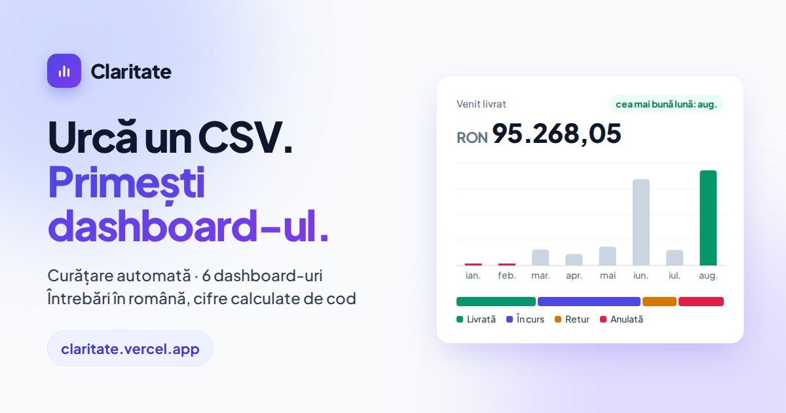

# Claritate: a dashboard from any CSV or Excel file



**Status: live** at [claritate.vercel.app](https://claritate.vercel.app). Originally built on Val Town; migrated in full to Vercel when Val Town shut down (`README-VERCEL.md` has the migration history, including the real bugs hit along the way and how they were fixed).

You upload a sales CSV **or an Excel file** (`.xlsx`/`.xlsm`/`.xls`) and the app **reads** it, **detects its columns**, **cleans** it, and shows you **6 dashboards** with figures, charts, and tables. You can also ask **questions in natural language** about the data. When an AI model is wired in, it only chooses **what** gets calculated — **the code calculates every figure**. The live deployment has no AI model attached (Val Town's free one doesn't exist outside Val Town, and no paid key has been added), so questions go through the same **rule-based planner** the app already falls back to when the model is unavailable — fewer phrasings understood, same guarantee that no number comes from the model.

> **Portfolio demo project** — scoped, built, and tested like a live product delivered to a real client. The "Testing and quality" and "How it was built" sections below show the process behind it, for anyone who wants to see how it came together.

---

## How to use it

1. Open the link and **drag a CSV or Excel file** onto the page, or click one of the **4 non-conforming examples**.
2. See immediately **what the app understood** from the file (each column's detected role, which you can correct) and **what it cleaned** (the rows removed and why).
3. Go through the **6 tabs**, pick a **currency** (RON / EUR), and ask questions.
4. **Copy the link** to send the dashboard to someone (every uploaded file gets its own address, `/d/…`).

## The 6 dashboards

| # | Dashboard | What it shows |
|---|---|---|
| 1 | **General summary** | order count, total value, **mean and median**, the largest order, orders by status |
| 2 | **Delivered revenue** | only **Delivered**-status orders, the month-by-month trend, top products |
| 3 | **Lost revenue** | **Returns + Cancellations**, the split between them, the customers with the biggest losses |
| 4 | **Best / worst month** | based on delivered revenue; months with orders but **0 deliveries** are counted as 0; the last month is flagged as "**incomplete month**" if the data cuts off before month's end |
| 5 | **Top customers and products** | ranked by delivered revenue, with each one's **share** of the total, and a warning for duplicate IDs |
| 6 | **Order health** | delivery, return, and cancellation rates, plus the money tied up **"In progress"** |

The app uses "**delivered revenue / lost revenue**", not "profit / loss": the files carry no cost data, so profit can't be calculated correctly. If a column is missing (e.g. **status**), the dashboard says explicitly what's missing instead of inventing it.

## Messy data: what it finds and what it does

A real example, `vanzari_2026.csv`: **145 rows** under the header → **129 valid orders**.

| Problem in the file | What the app does |
|---|---|
| 3 lines of text before the table | finds the **real header row** on its own (line 5) |
| completely empty rows | removes them (**3**) |
| `PARTIAL TOTAL` / `GRAND TOTAL` rows mixed in | removes them (**7**), otherwise they'd double the sums |
| the same order twice | keeps one (**6** exact duplicates) |
| the same ID with **different content** (e.g. `CMD-400003`) | **keeps both** and warns, since there's no way to know which is correct |
| amounts as text: `"1.841,86"`, `1,841.86`, `RON 2.500` | reads both **Romanian and English number formats** |
| "Delta Foods SA", "DELTA FOODS SA", "delta foods sa " | **merges** them into a single customer |
| `Livrata`, `LIVRATA`, `livrata`, ` Livrata` | normalizes to **4 statuses**: Delivered, In progress, Return, Cancelled |
| columns in a different order, `;` or tab separator | detects **each column's role** from its name **and** its content |
| RON and EUR mixed together | calculates **separately per currency**, with **no conversion** and no invented exchange rate |
| an `.xlsx`/`.xls` file, even renamed without the right extension | detected by **file signature**, not just extension; the first sheet with data is converted to CSV before anything else runs |
| a "TOTAL" row whose label isn't in the first column (common once columns get reordered) | checked across **every id/category column**, not just the first cell — a real gap this fixed, caught while testing reordered files |

The full cleaning report is visible on the page ("**What I cleaned**" → "See the removed rows").

## The "the model never calculates numbers" rule

```
question in natural language
   → the model receives ONLY the question + the column names (no rows, no figures)
   → returns a JSON plan: which metric, which column, which filters, which grouping
   → the code VALIDATES the plan (columns exist, operations allowed)
   → the safety net corrects the plan if it contradicts the question
   → the code CALCULATES and writes the answer sentence itself
```

- Under every answer it shows **exactly what was calculated** ("Calculated: sum of value; where status = Return…") and **who chose the plan**: the model or the rules.
- **Safety net:** in early live testing, the model answered "how much did I lose to **returns**" by including Returns + Cancellations. For "worst month," it returned every month, ignoring status entirely. Since then, the code checks the plan before calculating: if the question explicitly says "returns," "cancellations," or "best/worst month," the plan is corrected before the calculation runs, and the correction is logged.
- **Any CSV:** the model also sees the **real name** of the numeric column (e.g. "Grade," "Amount"), so questions work on files that aren't sales data at all. If the model says "not possible" but the rule-based planner understands the question, the rules answer instead.
- **No API key needed (on Val Town):** the model used there was Val Town's free one (`std/openai`), with no key to manage. If it didn't respond (the limit was 10 requests/minute), the question automatically fell back to a **rule-based planner**, which also works without the model. **On Vercel**, that free model doesn't exist outside Val Town, so for now the app runs on the rule-based planner only, by design — see `README-VERCEL.md` for how a real key (OpenAI/Anthropic) would be added later without touching this logic.

## Testing and quality

- **10 automated tests** (`deno task test`, original Val Town version): figures from 2 files cross-checked **to the cent** against independent reports built with the `data` plugin (in `docs/`), a **synthetic non-conforming CSV** (`;` separator, English numbers, no status column, reordered columns), invalid files, a "bad" plan from the model that must be rejected, real malformed plans seen live, and a CSV that **isn't sales data at all** (school grades).
- **Template-independence tests** (`scripts/validate-shapes.ts`): CSVs with columns in a different order, different (including English) names, and fewer/more columns than the demo files — including files missing a status, currency, or category column entirely. All detected and cleaned correctly.
- **Real Excel test** (`scripts/validate-xlsx.ts`, `validate-upload-xlsx.ts`): an actual `.xlsx` file (not a renamed CSV) with two sheets — the app picks the sheet that has data, not just the first one — native Excel date and number cells, a blank row, a duplicate, and a total row whose label sits in the **last** column instead of the first. That last case caught a real bug (see the cleaning table above), fixed and re-verified.
- **Vercel runtime verification** (`scripts/smoke-test-node-handler.ts`): spins up a real `http.createServer` to simulate exactly how Vercel invokes the deployed function (raw Node `req`/`res`, not a Fetch `Request`) — this is what caught a real Edge→Node regression during the migration.
- **Verified live, in the browser, on the production deployment**: real CSV and Excel uploads, all 6 dashboards, a question, and a shared `/d/:id` link opened in a fresh tab to simulate an anonymous visitor — all correct.
- **Impeccable accessibility audit** (desktop 1280px and mobile 375px, original Val Town version): initial score 15/20. Fixed: tap targets under **44px**, **contrast** below AA, a long filename wrapping badly on mobile, and **heading order** (h1 → h2). After the fixes: no horizontal scroll, no low-contrast text, no undersized tap targets (except the chart bars on mobile, which have a table alternative).

## How it was built

| Plugin | Marketplace | What it concretely did |
|---|---|---|
| **`valtown`** | `claude-plugins-official` | checked Val Town imports against current docs (`std/sqlite`, `std/openai`, `std/utils`), created the val `AlexandraM/claritate`, uploaded the files, set the short link `claritate.val.run`, and read the logs for the live tests — this was the original Val Town deploy, before the Vercel migration below |
| **`data`** | `knowledge-work-plugins` | `/data:explore-data` on `vanzari_2026.csv` and `/data:validate-data` on `vanzari_enterprise_b2b_2026.csv`: the catalog of non-conformities and the **reference figures** the tests check against (`docs/`) |
| **`impeccable`** | `impeccable` | the design/accessibility audit above and the fixes in `frontend/` |

**Other tools (not plugins):** Claude (Cowork) wrote the code. A **designer agent** used as a reference (`materiale-referinta/design-system.md`, the "Corporate Trust" style) set the visual direction, adapted in `DESIGN.md`. The **dataviz** skill validated the chart palette (including for color blindness).
**Not used:** `/data:create-viz` (the charts are SVG written directly in code) and `typescript-lsp` (type checking was done with `deno check`).

**Val Town → Vercel migration, and the Excel addition:** both done directly in Claude (Cowork), not through a plugin. `backend/core/*` (column detection, cleaning, the 6 dashboards, the question planner) didn't need to change at all for the migration — it never depended on Val Town. What changed: a new `api/[...route].ts` **Node.js** function (not Edge — a platform-level 404 on multi-segment `/api/...` routes forced that switch, cause never fully identified despite extensive elimination, worked around by moving the dashboard id from the path into a query string) replacing `main.ts`, Upstash Redis (`vercelKvStore()` in `backend/db.ts`) replacing SQLite, and `public/` for static files. Excel support (`.xlsx`/`.xlsm`/`.xls`, detected by file signature, converted to CSV before entering the unchanged pipeline) was added afterward, using the SheetJS CDN build instead of the npm package, which carries two unpatched high-severity CVEs relevant to an app that parses public uploads. Full breakdown, every bug hit, and how each was fixed are in `README-VERCEL.md`.

## Project structure

```
api/[...route].ts         Node.js serverless function entry point — the active deployment
api/_examples.generated.ts the 4 demo CSVs, embedded (no point reading static files from disk on every request)
backend/app.ts            routes (upload, dashboard, questions) + Excel detection/conversion before analyze()
backend/db.ts             storage: vercelKvStore() (active, Upstash Redis), sqliteStore()/memoryStore() (unused/local)
backend/core/csv.ts       CSV reading (quotes, separator, BOM)
backend/core/normalize.ts numbers, dates, statuses, currencies
backend/core/detect.ts    header and each column's role
backend/core/clean.ts     cleaning + the report
backend/core/aggregate.ts the 6 dashboards
backend/core/ask.ts       question → plan → validation → safety net → calculation
public/                   static files Vercel serves directly: index.html, frontend/, examples/, og.jpg
vercel.json               rewrites /d/:id → /index.html so shared dashboard links work
scripts/smoke-test.ts              the ported backend runs under real Node + npm hono
scripts/smoke-test-node-handler.ts simulates the exact Vercel invocation (http.createServer + getRequestListener)
scripts/validate-shapes.ts         CSVs with reordered/renamed/missing/extra columns — no fixed template
scripts/validate-xlsx.ts           a real multi-sheet .xlsx, native Excel dates/numbers, caught the total-row bug
scripts/validate-upload-xlsx.ts    /api/upload with a real .xlsx over HTTP, including a mislabeled file
tests/core_test.ts        the 10 original tests (figures, not the Vercel plumbing)
examples/ · frontend/     the original Val Town copies of what's now duplicated into public/
PLAN.md · CLAUDE.md · DESIGN.md · docs/ · README-VERCEL.md
materiale-referinta/      the original brief, the plugin list, the reference design system, and the original demo datasets

main.ts · dev.ts · deno.json   the old Val Town/Deno entry points — kept for history only,
                                 don't run anymore locally since backend/app.ts now imports
                                 "hono" from npm instead of Deno's npm: specifier
```

**Running locally (Vercel version):** no dev server wired up yet — `npm install` then `npx tsx scripts/smoke-test.ts` exercises the ported backend directly (upload, dashboard, ask, 404, 400); the `validate-*.ts` scripts exercise the template-agnostic parsing and Excel support the same way. A real local server would be `vercel dev` (Vercel CLI, after `vercel link`).
**Tests:** `deno task test` still runs the original 10 tests against `backend/core/*` (unaffected by the migration or the Excel addition, since that code's public behavior didn't change — only a bug fix in the total-row detection, which the new scripts cover).

## Known limits

- Files up to **5 MB** / **50,000** rows, CSV or Excel.
- Excel files: only the **first sheet with data** is read (a blank cover sheet is skipped automatically); other sheets are ignored.
- Currencies are **not converted**: each keeps its own figures.
- Anyone with a dashboard's link can view it (there's no login), so the page explicitly says **not to upload confidential data**.
- No AI model is wired in — every question goes through the **rule-based planner**, which understands fewer phrasings than a model would. (On Val Town, the free model had a rate limit; past it, the rules took over the same way.)
- Upstash Redis entries expire after **90 days** — an uploaded/shared dashboard older than that will 404. The 4 built-in examples are unaffected (they're static files, not stored in Redis).
